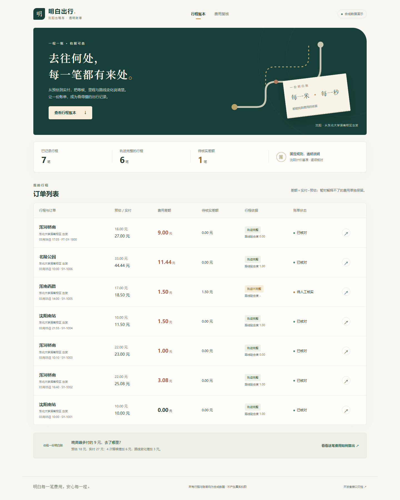
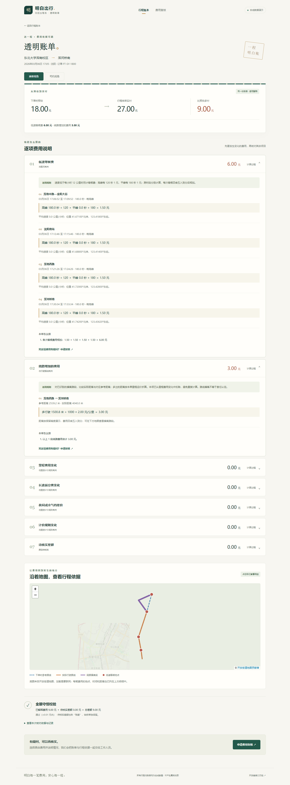
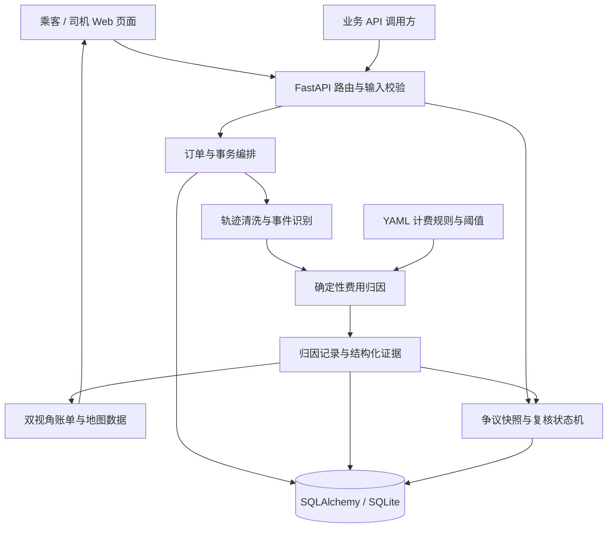

# FareTrace · 明白出行

**出租车透明账单与费用差额归因系统** · Explainable Taxi Fare Attribution

[](https://github.com/rryyyi/taxi-information-system/actions/workflows/ci.yml)
[](faretrace/requirements.txt)
[](faretrace/app/main.py)
[](faretrace/tests)

把“为什么比预估价多付了钱”转化为可以逐项计算、沿地图核对、发起复核的证据链。

FareTrace 是一个可本地运行的全栈业务原型：输入预估价快照、实付账单、参考路径和实际轨迹，输出七类费用归因、路口级等候事件、路段级绕行证据，以及乘客与司机两种账单视角。项目以沈阳出租车计价规则的**演示口径**建模，来自信息系统课程实践。

**当前实现为确定性规则引擎，尚未接入 LLM / Agent。** 它提供结构化业务接口、证据快照和复核状态机，可作为账单解释 Agent 的业务工具基础；[Agent 接入设计](docs/agent-integration.md)说明后续的工具调用、权限边界与评估方案。

[快速运行](#快速运行) · [架构与设计](#架构与设计) · [API 指南](faretrace/README.md) · [测试与质量](#测试与质量) · [工程边界](#工程边界)

## 一个具体问题：18 元为什么变成 27 元？

晚高峰示例订单 `FT-SY-1800`：从东北大学浑南校区前往浑河桥南，预估 **18.00 元**，实付 **27.00 元**。

| 费用来源 | 可核对的依据 | 差额 |
| --- | --- | ---: |
| 低速等候 | 4 次等候，每次 180 秒；演示高峰规则为 120 秒 / 元 | +6.00 元 |
| 绕行增量 | 偏离参考路径的路段多行驶约 1,500 米，连续归因费率 2 元 / 公里 | +3.00 元 |
| 其他五类归因 | 在这个示例中均为零 | 0.00 元 |
| **合计** | **27.00 − 18.00 = 6.00 + 3.00** | **+9.00 元** |

每项费用关联时间、坐标、计算公式和规则版本。证据不足的差额单独保留为残差，供人工核查。绕行证据用于解释路线变化，不能直接作为司机违规的结论。

## 界面预览

订单页聚合预估 / 实付、费用差额、待核实金额和轨迹质量；账单页提供逐项计算、地图证据与费用复核入口。截图来自本地合成数据演示。



<details>
<summary>展开查看透明账单与地图证据</summary>



</details>

## 已实现的业务闭环

| 能力 | 实现方式 | 代码入口 |
| --- | --- | --- |
| 差额归因 | 始终输出七项归因；保留零金额项、公式与证据 | [attribution.py](faretrace/app/services/attribution.py) |
| 轨迹处理 | 排序、去重、异常点过滤、低速段和偏离段识别 | [trajectory.py](faretrace/app/services/trajectory.py) |
| 地理计算 | Haversine 距离、局部平面投影与折线索引复用 | [geo.py](faretrace/app/services/geo.py) |
| 规则管理 | YAML 配置、日夜档与高峰窗口、阶梯返空费 | [shenyang.py](faretrace/app/services/shenyang.py) / [配置](faretrace/config/attribution.yaml) |
| 双视角解释 | 同一份归因投影为乘客 / 司机视图，减少口径分歧 | [bill_view.py](faretrace/app/services/bill_view.py) |
| 地图举证 | 参考路线、实际路线、偏离路段、等候点与起终点 | [bill.html](faretrace/app/templates/bill.html) |
| 争议复核 | 冻结发起时证据快照；校验状态流转；记录处理结果 | [disputes.py](faretrace/app/services/disputes.py) |
| 接口与存储 | Pydantic 输入校验、统一错误结构、请求级事务与 ORM | [routers](faretrace/app/routers) / [db.py](faretrace/app/db.py) |

### 七类费用与金额约束

```text
实付 − 预估
  = 等候费 + 绕路增量 + 里程费增量 + 阶梯返空费
  + 夜间 / 冷气档差价 + 计价规则变化 + 未解释残差
```

- 金额使用 `Decimal`，按 `ROUND_HALF_UP` 保留两位小数，守恒校验容差为 **0.01 元**。
- `PRICING_RULE_CHANGE` 在当前固定基准下恒为零；日夜档差异单独归入 `NIGHT_SURCHARGE`。
- 残差绝对值 **≤ 0.01 元**时归零；超出即在解释中提示待核查。当前配置在绝对值 **> 1.00 元**时将整体归因状态提升为 `NEEDS_REVIEW`。
- 轨迹不足时降级输出，不认定缺少证据的等候或绕行费用；保留质量标记。
- 每次归因记录 `algorithm_version`、`config_version`、`revision`。重算更新当前归因版本，已冻结的争议快照保持不变。

## 架构与设计



业务计算与 HTTP / 页面层分离：归因入口返回结构化草稿，持久化由服务编排完成。这样可以对金额和轨迹逻辑独立测试，也便于将现有接口作为后续 Agent 的工具接口。

争议记录在创建时拷贝账单、归因项、版本与证据，而不是始终引用最新结果，避免重算改变复核依据。这里的“冻结”是应用层快照语义，尚未实现密码学防篡改或不可变存储。

轨迹计算复用参考折线的投影索引，并以输入与相关配置为键提供有界 LRU 缓存。仓库包含可复现负载脚本；具体耗时应在同一机器与相同参数下测量，未宣称生产吞吐或延迟指标。

### 与 Agent 工程的联系

| 工程关注点 | 当前可检查的实现 | 后续 Agent 接入方向（未实现） |
| --- | --- | --- |
| 工具契约 | HTTP 接口、Pydantic Schema、统一错误码 | 为只读查询生成工具定义，验证参数与返回结构 |
| 事实与证据 | 金额、公式、事件、配置版本、证据 JSON | 根据工具返回解释账单，并引用具体归因项 |
| 不确定性处理 | 数据质量、残差和降级状态 | 证据不足时明确说明，并转交人工复核 |
| 人工协作 | 争议状态机与证据快照 | 用户确认后创建争议，处理结果由人工复核 |
| 可复现评估 | 合成场景、金额守恒与 API 回归测试 | 评估工具选择、数字一致性、证据引用和越权行为 |

详细方案与验收指标见 [Agent 接入设计](docs/agent-integration.md)。当前代码不包含自然语言对话、RAG、模型调用或多 Agent 编排。

## 快速运行

本地已在 **Python 3.14** 上验证。依赖采用精确版本锁定；建议使用独立虚拟环境。运行主流程无需模型服务、API Key 或 Node.js 构建。

```bash
git clone https://github.com/rryyyi/taxi-information-system.git
cd taxi-information-system/faretrace
python -m venv .venv
```

激活虚拟环境，按终端选择一条：

```bash
# macOS / Linux
source .venv/bin/activate
```

```powershell
# Windows PowerShell
.\.venv\Scripts\Activate.ps1
```

Windows Git Bash 使用 `source .venv/Scripts/activate`；也可直接使用虚拟环境中的 Python 执行后续命令。

```bash
python -m pip install -r requirements.txt
python -m pytest
python -m uvicorn app.main:app --reload --host 127.0.0.1 --port 8000
```

首次启动自动创建 SQLite 数据库，并向空库写入 **7 笔合成订单**。

| 入口 | 地址 |
| --- | --- |
| 行程账本 | http://127.0.0.1:8000/orders |
| 18 → 27 元样例 | http://127.0.0.1:8000/orders/FT-SY-1800/bill |
| 轨迹缺失样例 | http://127.0.0.1:8000/orders/SY-1005/bill |
| 费用复核 | http://127.0.0.1:8000/disputes/new |
| Swagger / OpenAPI | http://127.0.0.1:8000/docs / http://127.0.0.1:8000/openapi.json |

Leaflet 静态资源随仓库提供；底图瓦片需要联网。底图不可用时仍可展示已有轨迹和事件图层。OSRM / Nominatim 仅用于可选的离线路线准备脚本，归因流程不会实时请求这两项服务。

### 配置

| 环境变量 | 默认值 | 作用 |
| --- | --- | --- |
| `FARETRACE_DB_URL` | `faretrace/faretrace.db` 对应的 SQLite URL | 指定数据库位置；测试使用临时库 |
| `FARETRACE_CONFIG` | `faretrace/config/attribution.yaml` | 指定规则文件；缺失时直接报错 |
| `FARETRACE_SEED_ON_START` | `1` | 设为 `0` / `false` / `no` 可关闭启动灌种子 |

配置在进程中缓存，修改规则后需重启，并维护配置版本。`python seed.py` 和 `POST /api/demo/reset` 都会**重建演示数据**，仅应用于可丢弃数据库。

### API 试用

启动服务后，在另一个终端运行：

```bash
curl http://127.0.0.1:8000/api/health
curl http://127.0.0.1:8000/api/orders/FT-SY-1800/attribution
curl http://127.0.0.1:8000/api/orders/FT-SY-1800/events
curl "http://127.0.0.1:8000/api/orders/FT-SY-1800/bill?view=passenger"
```

Windows PowerShell 建议使用 `curl.exe`。完整建单、完单和争议流转示例见 [API 指南](faretrace/README.md#接口一览与-curl-示例)。

## 测试与质量

在 `faretrace/` 下运行：

```bash
python -m pytest
python -m pytest tests/test_attribution.py tests/test_api.py
python scripts/bench_attribution.py 500
```

当前测试套件包含 **83 项测试**，覆盖配置、地理计算、计费规则、轨迹预处理、归因守恒、API 与页面渲染。API 测试使用独立临时库，不污染演示数据库。页面测试为服务端渲染与 HTML 冒烟检查，尚未覆盖真实浏览器端到端交互。

基准脚本对 7 笔种子订单预热后重复归因，每轮执行三次测量并输出最小总耗时，单位为 **毫秒**；默认每次测量 500 轮。结果主要反映相同输入的缓存热路径，不能替代冷启动、大规模新轨迹或并发测试。

[GitHub Actions](.github/workflows/ci.yml) 在 push / PR 时从干净环境安装依赖并运行测试；依赖更新由 [Dependabot](.github/dependabot.yml) 定期提出 PR。

## 仓库导航

```text
.
├── README.md                     # 项目首页
├── CONTRIBUTING.md               # 本地验证与贡献约定
├── .github/                      # CI、依赖更新、Issue / PR 模板
├── docs/
│   ├── agent-integration.md      # Agent 接入设计（未实现）
│   └── operations.md             # 运行、部署边界与故障排查
└── faretrace/
    ├── app/
    │   ├── routers/              # REST API 与页面路由
    │   ├── services/             # 计费、轨迹、归因、证据与复核
    │   ├── models.py schemas.py  # ORM 与输入 Schema
    │   └── templates/ static/    # Jinja2 页面、样式与本地 Leaflet
    ├── config/attribution.yaml   # 规则、阈值与版本
    ├── tests/                    # 自动化测试
    ├── scripts/                  # 路线准备与性能基准
    ├── deploy/                   # Linux 演示部署脚本
    ├── docs/                     # 设计、用例、验收与截图
    ├── ASSUMPTIONS.md            # 演示口径与假设
    └── requirements.txt          # 精确版本依赖
```

- [系统设计与数据模型](faretrace/docs/system-design.md)
- [业务用例](faretrace/docs/use-cases.md) / [验收清单](faretrace/docs/acceptance-checklist.md)
- [技术假设](faretrace/ASSUMPTIONS.md) / [资料来源](faretrace/docs/references.md)
- [运行维护](docs/operations.md) / [贡献指南](CONTRIBUTING.md)

## 工程边界

- **数据与计价**：全部订单、轨迹和账单为合成数据；道路锚点使用沈阳地名和近似坐标。计价规则包含演示假设，尤其跨夜档位与夏季冷气处理，不构成对真实计价器或现行政策的合规认证。
- **数据耐久性**：当前 SQLite 连接使用 `synchronous=OFF` 与内存日志，适合可重建的演示库；不能承诺崩溃后的账务数据完整性。
- **访问控制**：乘客 / 司机视角是展示投影，尚无身份认证、角色授权和数据隔离；演示重置接口默认开放。公网部署前需要补齐这些能力。
- **上线条件**：尚无数据库迁移、限流、完整可观测性、备份恢复演练和生产压测。仓库提供 Nginx / systemd 演示脚本，执行前请阅读[运行维护说明](docs/operations.md)。
- **许可**：当前未为项目自有代码选择开源许可证；公开可见不等于已授权任意再分发。Leaflet 等第三方组件适用各自许可，见[第三方说明](THIRD_PARTY_NOTICES.md)。
