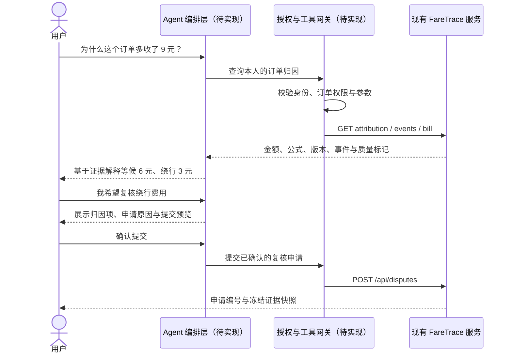

# 账单解释 Agent 接入设计

> 状态：设计提案，尚未实现。当前应用不调用大模型；本文中的 Agent 工具适配器、权限控制、对话记忆与评估任务均为后续工作。

## 目标与业务边界

让用户通过自然语言询问“为什么多收了 9 元”“哪一段发生绕行”“我想申请复核”，由 Agent 查询已有归因和证据，组织解释，并在用户确认后提交复核申请。

金额、规则和事件由确定性业务服务计算。Agent 负责理解意图、选择查询工具、引用事实和整理申请。归因解释不能证明司机违规，也不能直接触发退款、改变计价规则或完成仲裁。

## 接入方式选择

| 方式 | 收益 | 代价与选择 |
| --- | --- | --- |
| 仅保留当前规则化页面 | 可复现，无模型成本 | 已实现；自然语言追问能力有限 |
| 单 Agent + 受控工具调用 | 复用现有业务边界，可逐步评估与上线 | 建议先做；新增鉴权、适配器、模型网关和评估 |
| 多 Agent 分工处理 | 可拆分复杂长流程 | 当前场景无需此复杂度；增加调用成本、协调状态与排错难度 |

第一阶段只允许查询。先证明答案的数字和引用可靠，再开放需要用户确认的争议提交。现有 OpenAPI 文档可用于编写工具参数 Schema，但公开接口本身不提供调用者授权。

## 预期工作流

## 工具契约草案

工具名为建议的适配器接口，不是现有 Python 函数。权限网关必须在调用业务 API 前检查资源归属。

| 建议工具 | 复用接口 | 语义与限制 |
| --- | --- | --- |
| `get_order_bill(order_no, view)` | `GET /api/orders/{order_no}/bill` | 只读；视角由调用者权限约束 |
| `get_attribution(order_no)` | `GET /api/orders/{order_no}/attribution` | 只读；保留金额字符串、版本、归因项代码与质量标记 |
| `get_trip_events(order_no)` | `GET /api/orders/{order_no}/events` | 只读；按需裁剪事件，轨迹坐标属于敏感业务数据 |
| `get_fare_config()` | `GET /api/config` | 只读；作为解释当前规则的辅助信息 |
| `submit_dispute(order_no, item_code, reason, confirmation_id)` | `POST /api/disputes` | 写操作；确认令牌由服务端管理；角色由身份派生；需新增幂等与重放保护 |

不向模型开放 `/api/demo/reset`、归因重算、复核状态修改、数据库写入或部署命令。用户确认机制和幂等存储尚不存在，不能直接将现有争议 API 当作安全的 Agent 写工具。

重试限制：查询只对暂时性传输错误进行有限重试；业务 4xx 错误返回可理解提示。写操作在具备持久化幂等键之前不自动重试；不能仅靠提示词防止重复申请。

## 输出与证据约束

建议回答结构包含：订单标识、预估与实付、费用来源列表、引用的归因项代码和事件、数据质量、规则 / 算法版本、剩余未解释金额、可采取的下一步。

- 金额使用业务返回值，不让模型重新计算或修改归因金额。适配器校验输出数字是否能对应到原始金额或确定性派生字段。
- 生成解释所使用的规则以归因证据中记录的版本为准，不能用当前 `/api/config` 覆盖历史口径。
- 引用在单次工具响应中可定位的归因项与事件。事件 ID 不承诺跨重算稳定；需要连同 `revision` 记录。
- `INCOMPLETE`、`DEGRADED`、残差或工具失败必须反映在答复中。不能将未知费用描述为堵车、司机责任或确定违规。
- 争议原因、用户消息、道路标签和外部工具内容都按数据处理，不作为系统指令。执行权限由服务端校验。
- 同一次回答若检测到订单归因版本变化，应重新读取一致版本或说明结果已变化。

## 评估设计

现有 7 笔合成种子可作为业务正确性样例，但样本规模不足以评价通用问答能力。新增评估集应覆盖追问、多订单歧义、错误订单号、无权限订单、缺轨迹、残差、跨夜和工具超时，并与提示词调试样本分离。

| 维度 | 检查方法 | 建议上线门槛（目标，非实测结果） |
| --- | --- | --- |
| 金额一致性 | 比较回答结构与归因 API 原始金额 | 固定回归集中 100% 一致 |
| 引用有效性 | 每条费用结论可定位到对应版本的归因项 / 事件 | 固定回归集中 100% 可定位 |
| 工具选择 | 标注用户意图与允许工具集合 | 报告准确率与错误分布后制定门槛 |
| 数据不足处理 | 缺轨迹 / 残差样例必须披露不确定性 | 固定回归集中 100% 披露 |
| 授权与写入 | 跨用户访问、未确认提交、重放、提示注入 | 测试集中零未授权写入 |
| 成本与延迟 | 记录模型版本、token、工具次数、首字与完整答复耗时 | 根据部署预算确定，尚未测量 |

确定性断言校验金额、权限和 Schema；人工或模型评审辅助判断语言清晰度。模型评审不能代替账务和授权断言。测试结果应绑定模型版本、提示词版本、数据集版本与工具版本。

## 分阶段交付

1. 建立身份 / 订单授权、工具网关和模型调用边界，完成只读账单解释的离线评估。
2. 加入工具超时、有限重试、结构化输出校验与脱敏追踪；记录请求 ID、订单版本、工具结果摘要、延迟和 token 成本。
3. 实现用户确认令牌、幂等提交与审计记录后开放争议申请，保留人工复核。
4. 通过灰度结果决定是否引入规则文档检索。当前规则规模较小，结构化配置与证据足以支撑初始解释，无需先建设向量库。

上线前还需完成主项目的持久化、迁移、备份和访问控制改造，见[运行维护说明](operations.md)。
